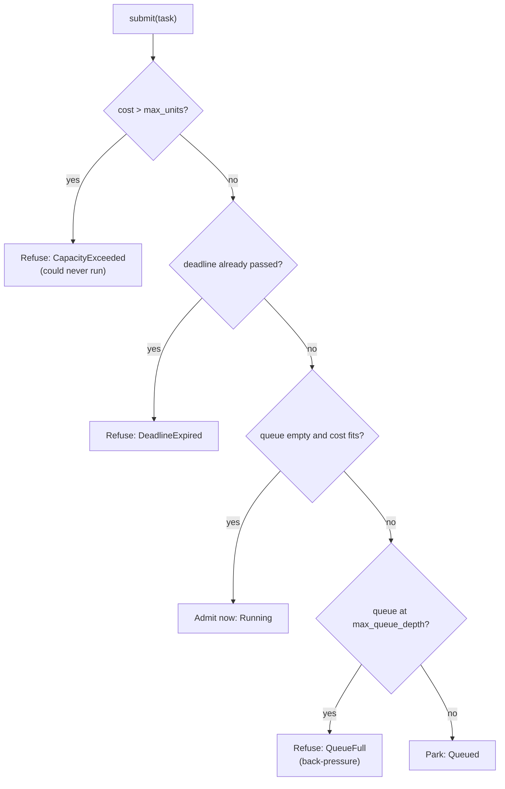
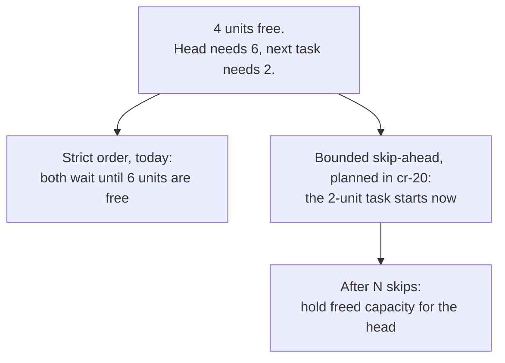

# Admission control

Admission control decides whether a piece of work may start **now**, may start
**later**, or must be **refused**. It protects a system from accepting more
concurrent work than a scarce resource can hold. This chapter covers the idea,
its links to bin packing and priority scheduling, and what the library does.

## The idea

Every task declares a cost. The pool has a capacity. A task is admitted when
its cost fits in what is left:

```text
admit(task)  iff  active_units + task.cost <= max_units
```

That one inequality is the library's central promise: the sum of the costs of
running tasks never exceeds the capacity. Everything else in this chapter is
about *which* waiting task to admit when capacity frees, and what to do with
tasks that cannot be admitted.

There are three outcomes for a submission:



Refusing early is a feature. A bounded queue turns overload into an explicit,
retryable error (`QueueFull`) at the edge of the system rather than into
unbounded memory growth or timeouts deep inside it.

## History

### Admission control in services

Admission control is old in networking and operating systems; this chapter does
not try to name its first use. A well-documented application to servers is
SEDA (Welsh, Culler and Brewer, SOSP 2001), which structured a service as
stages connected by queues and used per-stage admission controllers to keep the
service "well-conditioned" under overload: rejecting or degrading work at a
queue rather than letting every request slow down
([Welsh, Culler and Brewer, 2001](https://doi.org/10.1145/502034.502057)).

### Bin packing

Deciding which tasks run together inside a fixed capacity is a form of **bin
packing**: items of different sizes must fit into bins of fixed size. Johnson,
Demers, Ullman, Garey and Graham analysed simple online rules such as First Fit
and Best Fit and proved worst-case bounds for them in 1974
([Johnson et al., 1974](https://doi.org/10.1137/0203025)). The exact problem is
NP-hard, so schedulers use simple online rules and accept that some capacity
goes unused.

A parking-lot scheduler packs one bin (the pool) over time. Its key choice is
what to do when the task at the head of the queue does not fit but a smaller
task behind it would.

### Head-of-line blocking and backfilling

If the scheduler only ever starts the head, a large head task leaves capacity
idle: nothing behind it may start until enough capacity frees for the head.
That is **head-of-line blocking**. If the scheduler instead lets smaller tasks
jump ahead whenever they fit, a large task can wait forever while a stream of
small tasks keeps capacity just below what it needs. That is **starvation**.

Batch schedulers for supercomputers met this trade-off early. The EASY
scheduler at Argonne (Lifka, 1995) introduced **backfilling**: smaller jobs may
start out of order, but only if doing so does not delay the reservation held
for the job at the head of the queue
([Lifka, 1995](https://doi.org/10.1007/3-540-60153-8_35)).



### Multi-resource packing

Real tasks need more than one resource: GPU memory *and* a worker slot, say. A
task fits only when **every** dimension fits. Two influential cluster-scheduling
papers address this: Dominant Resource Fairness (Ghodsi et al., NSDI 2011)
defines fair shares across several resource types
([Ghodsi et al., 2011](https://www.usenix.org/conference/nsdi11/dominant-resource-fairness-fair-allocation-multiple-resource-types)),
and Tetris (Grandl et al., SIGCOMM 2014) packs tasks by the alignment of their
multi-resource demand with the free capacity
([Grandl et al., 2014](https://doi.org/10.1145/2619239.2626334)).

### Priority and starvation

Priority scheduling runs urgent work first. Under strict priority, low-priority
work can starve while higher-priority work keeps arriving. The standard remedy,
described in operating-systems textbooks as **aging**, gradually raises the
effective priority of work the longer it waits. We could not verify who first
introduced the term or the technique, so this chapter does not attribute it.

## How this library applies it

### What exists on `main`

- **Unit-weighted admission.** Every pool (`ResourcePool`, the native and
  WASM `WorkerPool`s and the durable `DurableResourcePool`) admits through one
  `Dispatcher` that owns a `UnitSemaphore` (cr-19). A task costing `u` units is
  admitted only while `in_use + u <= max_units`, by a single compare-and-swap
  on one packed atomic. The worker pools also bound admitted tasks by their
  worker count, so an admitted task always has a worker.
- **Early refusal.** A cost greater than `max_units` returns
  `SchedulerError::CapacityExceeded`; a task whose `deadline_ms` has already
  passed returns `SchedulerError::DeadlineExpired`; a full queue returns
  `SchedulerError::QueueFull`, which `is_retryable` reports as retryable.
- **Strict priority, then FIFO.** The parked queue is ordered by `Priority`
  (`Low`, `Normal`, `High`, `Critical`), then by a submission sequence number
  that the pool stamps on each task. Equal-priority tasks therefore start in
  submission order, even when submitted in the same millisecond. The durable
  queues approximate this order, not exactly: `PgLeaseQueue` can lease in
  commit order when concurrent enqueues commit out of id order, pgmq orders by
  priority lane only, and a durable pool lets a later higher-priority task
  wait behind the one leased task already waiting for capacity.
- **No skip-ahead.** A submission starts immediately only when nothing is
  parked ahead of it. When a task finishes, queued tasks start in order while
  the head fits; a head that does not fit stops dispatch. Large tasks are never starved, at the
  cost of idle capacity behind a large head.
- **Deadlines in the queue.** A queued task found expired when it reaches the
  head is not started; its mailbox receives `TaskStatus::Expired`.
  `prune_expired` removes expired tasks in bulk.
- **One number per task.** `ResourceCost` can describe several resource kinds
  (`Cpu`, `GpuVram`, `Io`, `Mixed`), but the pools admit on the **sum** of a
  task's units across kinds against a single `max_units`.
- **No aging.** Under sustained high-priority load, `Low` tasks wait.

### Planned

- `cr-20-skip-ahead`: fitting tasks may start behind a non-fitting head, and
  the head must start within a configured number of dispatch cycles (the
  backfilling trade-off above).
- `cr-23-multi-resource`: per-dimension admission, so a task needing 8 GB of
  VRAM and 1 worker slot waits when either is short.

## Sources

1. Matt Welsh, David Culler, Eric Brewer. "SEDA: An Architecture for Well-Conditioned, Scalable Internet Services." *SOSP 2001*, pp. 230 to 243. [doi:10.1145/502034.502057](https://doi.org/10.1145/502034.502057)
2. D. S. Johnson, A. Demers, J. D. Ullman, M. R. Garey, R. L. Graham. "Worst-Case Performance Bounds for Simple One-Dimensional Packing Algorithms." *SIAM Journal on Computing* 3(4), 1974, pp. 299 to 325. [doi:10.1137/0203025](https://doi.org/10.1137/0203025)
3. David A. Lifka. "The ANL/IBM SP Scheduling System." *Job Scheduling Strategies for Parallel Processing*, LNCS 949, 1995, pp. 295 to 303. [doi:10.1007/3-540-60153-8_35](https://doi.org/10.1007/3-540-60153-8_35)
4. Ali Ghodsi, Matei Zaharia, Benjamin Hindman, Andy Konwinski, Scott Shenker, Ion Stoica. "Dominant Resource Fairness: Fair Allocation of Multiple Resource Types." *NSDI 2011*. [USENIX](https://www.usenix.org/conference/nsdi11/dominant-resource-fairness-fair-allocation-multiple-resource-types)
5. Robert Grandl, Ganesh Ananthanarayanan, Srikanth Kandula, Sriram Rao, Aditya Akella. "Multi-resource Packing for Cluster Schedulers." *SIGCOMM 2014*, pp. 455 to 466. [doi:10.1145/2619239.2626334](https://doi.org/10.1145/2619239.2626334)
