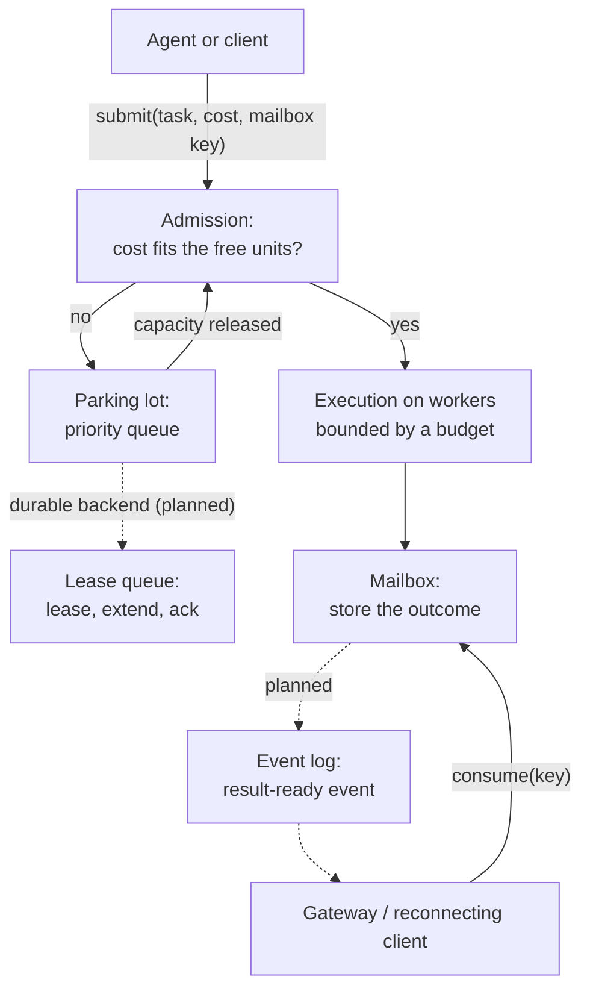

# Agentic value

The previous chapters each describe one old, well-understood idea. This chapter
explains why agentic AI workloads need all of them at once, and which part of
the library answers which pressure. Worked scenarios with code follow in the
[Guides](../guides/index.md) (change `cr-47-docs-guides`).

## Four pressures

An AI agent platform runs work that is unusual in four ways at the same time.

### 1. The scarce resource is memory, not CPU time

Serving a large language model keeps the model weights resident in GPU memory
and adds per-request state on top. Kwon et al. (SOSP 2023), the vLLM paper,
show the memory layout for a 13-billion-parameter model on an NVIDIA A100 with
40 GB: about 65% of memory holds the weights, and close to 30% holds the
per-request key-value (KV) cache. Their abstract notes that the KV cache "for
each request is huge and grows and shrinks dynamically"
([Kwon et al., 2023](https://doi.org/10.1145/3600006.3613165)).

Exceeding GPU memory is not a slowdown; it is an out-of-memory failure that can
take down every request on the device. A limit on the number of concurrent
requests is the wrong guard, because two large requests can need more memory
than ten small ones. The right guard is **weighted admission**: each task
declares what it needs, and the scheduler never admits more than the device
holds ([Admission control](./admission-control.md)).

### 2. Work is long-running and its length is unknown

Generation is token by token, so a request's run time depends on how much it
generates. The Orca serving system (Yu et al., OSDI 2022) responded by
scheduling "at the granularity of iteration" rather than whole requests,
because requests in a batch finish at different times
([Yu et al., 2022](https://www.usenix.org/conference/osdi22/presentation/yu)).
Agent workflows stretch this further: a single agent step may call tools, wait
on other services and run for minutes.

Long, variable work needs two things: a **budget** so that a wedged task cannot
hold capacity forever, and, for durable queues, a **lease that the worker
extends** while it is alive so that a long task is not mistaken for a dead one
([Leases and delivery](./leases.md)).

### 3. Clients disconnect

A browser tab closes, a phone changes networks, a desktop app is put to sleep.
If the only way to get a result is the connection that submitted the work, the
result is lost with the connection. An addressed **mailbox** lets the result
wait for the client, and a **notification on an event log** tells a reconnecting
gateway where to resume ([Mailboxes and actors](./mailboxes-and-actors.md),
[Event logs](./event-logs.md)).

### 4. Work is expensive to repeat

An inference run or a multi-step agent turn costs GPU time and money. Losing
accepted work on a restart, or silently running it twice, is a real cost.
That calls for durable parking with **at-least-once** delivery, plus
**idempotency** so the second run of a redelivered task does not produce a
second result.

## How the pieces fit

**GPU memory limit, answered by weighted admission.**
On `main`, `ResourcePool` admits by units and never exceeds `max_units`.
Planned: one shared semaphore for every pool (`cr-19`), per-resource admission
(`cr-23`) and bounded skip-ahead (`cr-20`).

**Long, variable work, answered by budgets and leases.**
On `main`, every `ResourcePool` execution is bounded by its deadline or
`default_timeout`. Planned: lease extension while a task runs (`cr-25`,
`cr-26`, `cr-49`).

**Disconnecting clients, answered by the mailbox and notifications.**
On `main`, outcomes are delivered to the mailbox, and `InMemoryMailbox`
supports consume-once and TTL. Planned: a readable Postgres mailbox (`cr-27`),
storage plus notifier composition (`cr-34`) and an Iggy notifier (`cr-32`).

**Expensive work, answered by durable at-least-once delivery and idempotency.**
Not on `main` yet: the Postgres queue deletes on dequeue and the file queue is
not crash-safe. Planned: the Postgres lease queue (`cr-26`), the redb queue
(`cr-28`) and acknowledgement after delivery (`cr-49`).

The honest summary for `main`: the capacity guarantee and the bounded execution
budget hold for `ResourcePool` today. Durable, crash-safe parking and
notifications are the subject of the current phase and are not yet available.

## Why one library

Each of these ideas exists elsewhere: queues with leases, actor mailboxes, event
logs, GPU-aware serving engines. What an agent platform lacks is the
combination in one place, with one task description, so that the same task is
admitted by weight, parked in priority order, survives a restart, and delivers
its outcome to a client that may no longer be connected. The serving engine
(for example vLLM) manages memory *inside* one model server; this library
decides which work is allowed to reach that server, and what happens to the
result afterwards.

## Sources

1. Woosuk Kwon, Zhuohan Li, Siyuan Zhuang, Ying Sheng, Lianmin Zheng, Cody Hao Yu, Joseph E. Gonzalez, Hao Zhang, Ion Stoica. "Efficient Memory Management for Large Language Model Serving with PagedAttention." *SOSP 2023*, pp. 611 to 626. [doi:10.1145/3600006.3613165](https://doi.org/10.1145/3600006.3613165)
2. Gyeong-In Yu, Joo Seong Jeong, Geon-Woo Kim, Soojeong Kim, Byung-Gon Chun. "Orca: A Distributed Serving System for Transformer-Based Generative Models." *OSDI 2022*. [USENIX](https://www.usenix.org/conference/osdi22/presentation/yu)
