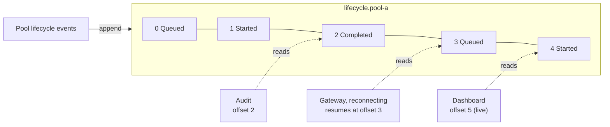
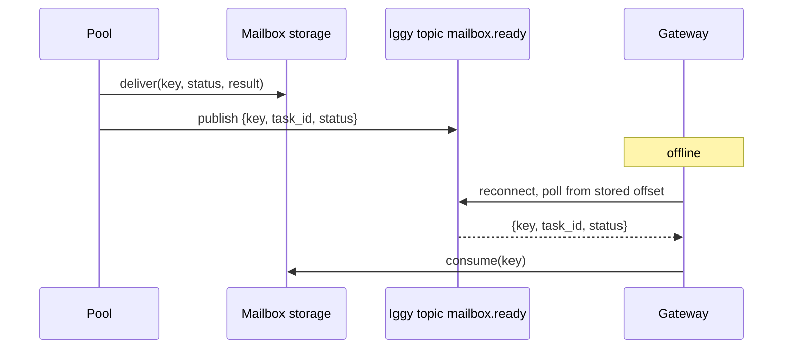

# Event logs

A queue hands each item to one consumer and forgets it. A **log** keeps every
item in order and lets any number of readers move through it at their own pace.
This chapter covers event logs, why they suit lifecycle events and
notifications, and why they do not suit the parking-lot work queue itself.

## The idea

An event log is an append-only, ordered sequence of records split into
partitions. Writers append. Each reader keeps an **offset**: the position of the
next record it wants. Reading does not remove anything; records expire by a
retention policy, usually whole files (segments) at a time.

Three properties follow:

- **Replay.** A reader that was offline resumes from its stored offset and sees
  everything it missed, in order.
- **Fan-out.** Many independent readers (dashboards, audit, a gateway) read the
  same records without coordinating.
- **No per-record state.** The log does not know whether a record was
  "handled". There is no per-message acknowledgement, lease or priority.

## History

### Kafka (2011)

Jay Kreps, Neha Narkhede and Jun Rao described Kafka at the NetDB workshop in
2011 as "a distributed messaging system that we developed for collecting and
delivering high volumes of log data with low latency" at LinkedIn. The paper
sets out the model that most event logs now share: a topic is divided into
partitions; each partition is a log stored as a set of segment files; a message
is addressed by its offset rather than an id; consumers pull, and the broker
does not track what each consumer has read. It also notes that a consumer can
deliberately rewind to an old offset and re-consume data, which "violates the
common contract of a queue, but proves to be an essential feature for many
consumers". Retention is time-based: messages are deleted after a configured
period ([Kreps, Narkhede and Rao, 2011](https://www.microsoft.com/en-us/research/wp-content/uploads/2017/09/Kafka.pdf)).

### Apache Iggy

Apache Iggy is a persistent message-streaming platform written in Rust. Its
documentation describes streams that group topics, topics split into
partitions, server-stored consumer offsets, consumer groups that keep ordering
per partition, and retention that expires messages by policy; it supports QUIC,
TCP, WebSocket and HTTP transports
([Iggy documentation](https://iggy.apache.org/docs/introduction/about/)).
Iggy joined the Apache Incubator in February 2025
([Iggy blog, 10 February 2025](https://iggy.apache.org/blogs/2025/02/10/apache-incubator))
and graduated to an Apache top-level project on 19 August 2026. The graduation
post describes it as "built on a thread-per-core design with io_uring for
disk/network I/O"
([Iggy blog, 24 August 2026](https://iggy.apache.org/blogs/2026/08/24/apache-iggy-top-level-project-tlp-graduation/)).

## What a log is good for here, and what it is not

The project's plan of record assessed Iggy against each job the library has.

| Job | Fit | Why |
| --- | --- | --- |
| Lifecycle events (queued, started, completed, failed, expired) | Strong | Append-only, ordered per partition, replayable, many readers |
| "Result ready" notification to a gateway | Strong | A reconnecting gateway resumes from its offset; no webhook retries |
| Streaming-token replay to a reconnecting client | Good | Per-session partition, resume from the last offset received |
| Mailbox storage (keyed read, consume-once, per-entry TTL) | Poor | No key lookup, no per-record delete, segment-level expiry |
| The work queue itself | Poor | No priority, no per-message lease or acknowledgement, no capacity-aware skip-ahead |

So the design keeps results in a store that supports keyed, consume-once reads
(Postgres or an embedded store) and publishes only a **pointer event** to the
log. This is the outbox ordering from [Leases and delivery](./leases.md): store
first, then announce.

## How this library applies it

### What exists on `main`

- There is **no Iggy integration** on `main`.
- `ResourcePool` accepts an `AuditSink` and records `enqueue`, `start`,
  `wake`, `complete`, `fail`, `timeout`, `expire` and `cancel` events through
  it.
- The core crate defines `LifecycleEvent`, the `Hook` trait and `HookBus`, but
  the pools do not emit lifecycle events through them yet.
- The place a notifier plugs in exists: `StorageMailbox<S, N>` (cr-34) stores a
  result first and then hands it to a `Notifier` off the delivery path, with
  bounded retries. The only built-in notifier is `NoopNotifier`.

### Planned

- `cr-31-hook-emission`: emit a lifecycle event at every transition, with no
  overhead when no hook is registered.
- `cr-32-iggy-events`: behind an `iggy` feature, an Iggy hook (lifecycle
  events, partitioned by tenant) and an Iggy notifier (`mailbox.ready`), with
  message ids derived from the idempotency key so retried publishes
  deduplicate, published from a bounded background channel rather than inline.
  Acceptance: a subscriber against a pinned Iggy server receives
  `mailbox.ready` and replays from an offset.
- `cr-33-stream-replay` (stretch): streaming-token replay for clients that
  disconnect mid-stream.

Iggy is used for events and notifications only, not as mailbox storage and
not as the work queue.

## Sources

1. Jay Kreps, Neha Narkhede, Jun Rao. "Kafka: a Distributed Messaging System for Log Processing." *NetDB 2011*, Athens, 12 June 2011. [PDF](https://www.microsoft.com/en-us/research/wp-content/uploads/2017/09/Kafka.pdf)
2. Apache Iggy. "About." Iggy documentation. [iggy.apache.org](https://iggy.apache.org/docs/introduction/about/)
3. Apache Iggy. "Iggy joins the Apache Incubator." 10 February 2025. [iggy.apache.org](https://iggy.apache.org/blogs/2025/02/10/apache-incubator)
4. Apache Iggy. "Apache Iggy graduates to a Top-Level Project." 24 August 2026. [iggy.apache.org](https://iggy.apache.org/blogs/2026/08/24/apache-iggy-top-level-project-tlp-graduation/)
