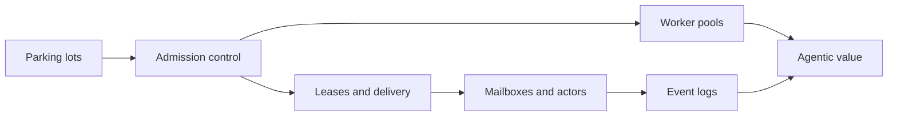

# Concepts

These chapters explain the ideas the library is built on: where each came from,
with citations to the original papers and documentation, and how the library
applies it. Each chapter separates what exists on `main` today from what is
planned, and names the OpenSpec change that plans it.

| Chapter | What it covers |
| --- | --- |
| [Parking lots](./parking-lots.md) | Futexes, WebKit's `WTF::ParkingLot` and Rust's `parking_lot`; how this library parks work instead of threads |
| [Admission control](./admission-control.md) | Weighted admission, bin packing, backfilling, multi-resource packing, priority and starvation |
| [Leases and delivery](./leases.md) | Leases, at-least-once delivery, `SKIP LOCKED`, pgmq, idempotency and the outbox pattern |
| [Mailboxes and actors](./mailboxes-and-actors.md) | The actor model and Erlang mailboxes; the result mailbox for disconnected clients |
| [Worker pools](./worker-pools.md) | Worker pools, work stealing from Cilk to Tokio, and dedicated threads for heavy work |
| [Event logs](./event-logs.md) | Kafka and Apache Iggy; events and notifications, not storage or the work queue |
| [Agentic value](./agentic-value.md) | Why agent workloads need all of the above together |

Statements about the library describe the code on `main`. When a chapter says
"planned", the behaviour does not exist yet; the
[changelog](https://github.com/Prometheus-AGS/prometheus-parking-lot-rs/blob/main/CHANGELOG.md)
records what has shipped.
