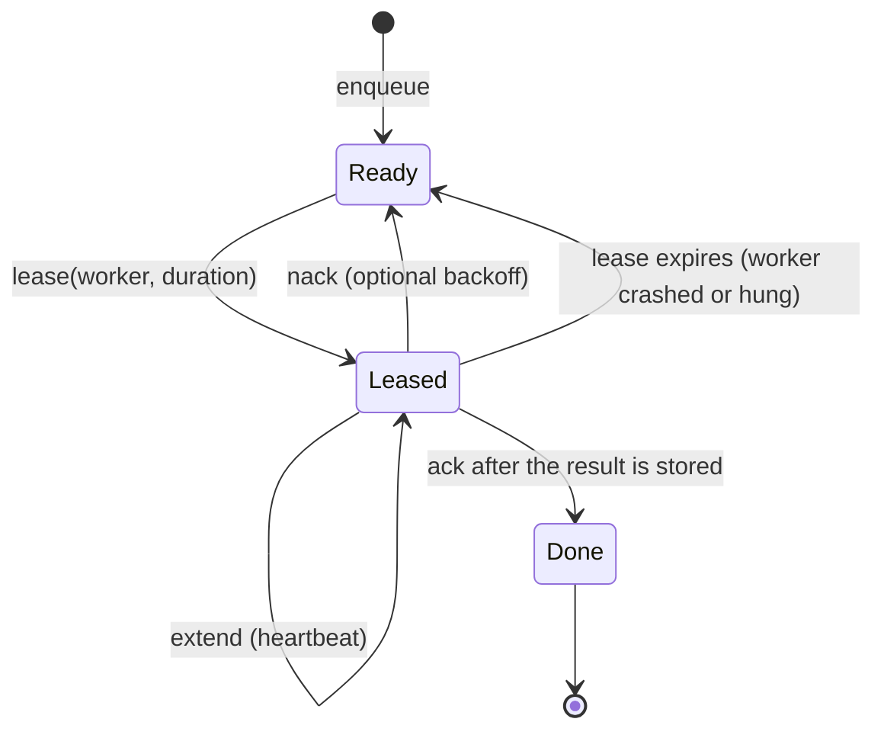
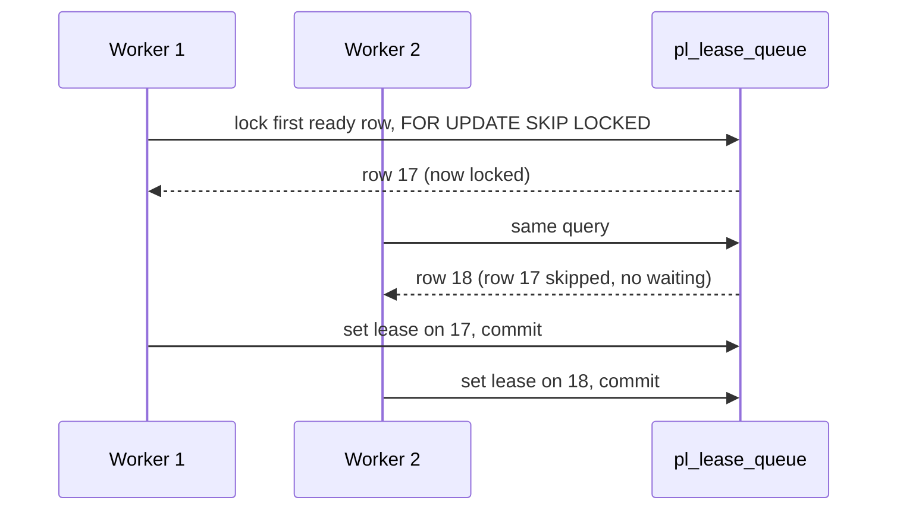

# Leases and delivery

A parked task is a promise: "this work was accepted and will run". Keeping that
promise across crashes is the job of the queue. This chapter covers the ideas
that make a queue durable without losing or silently duplicating work: leases,
at-least-once delivery, `SKIP LOCKED`, idempotency and the outbox pattern.

## The idea

Taking work from a queue has two dangerous moments:

- **Remove, then run.** If the worker deletes the task when it takes it and
  then crashes, the task is gone. This is *at-most-once* delivery.
- **Run, then remove.** If the worker takes a task without removing it, another
  worker may take it too, and if the worker crashes after finishing but before
  removing it, the task runs again. This is *at-least-once* delivery.

A **lease** makes the second option safe enough to use. Taking a task grants the
worker a time-limited right to it. While the lease is valid, nobody else may
take the task. The worker either **acknowledges** it (the task is done and is
removed), **releases** it (put it back, perhaps after a delay), or **extends**
the lease because it is still working. If the worker dies, the lease simply
expires and the task becomes available again.

Leases trade a possible duplicate for never losing work. Duplicates are then
handled by making the effect of a task **idempotent**: applying it twice has the
same result as applying it once.

## History

### Leases (Gray and Cheriton, 1989)

Cary Gray and David Cheriton introduced leases at SOSP in 1989 as a mechanism
for consistent distributed file caching. A lease is a time-bounded grant: the
holder may act on the data until the term ends, without further messages. Their
key observation is that failures (a crashed client, a lost message) then affect
performance, not correctness: the server only has to wait for the lease to
expire. They found that short terms, on the order of seconds, work well
([Gray and Cheriton, 1989](https://doi.org/10.1145/74850.74870);
[paper PDF](https://courses.cs.duke.edu/spring15/cps210/readings/leases-sosp89.pdf)).

The same idea appears in managed queues as the *visibility timeout*. In Amazon
SQS, a received message stays in the queue but is invisible to other consumers
until the timeout ends; if it is not deleted in time it becomes visible again.
The SQS documentation states that, because of the at-least-once model, a message
can still be delivered more than once, and it recommends a heartbeat that
extends the timeout for long work
([AWS SQS visibility timeout](https://docs.aws.amazon.com/AWSSimpleQueueService/latest/SQSDeveloperGuide/sqs-visibility-timeout.html)).

### End-to-end acknowledgement

Saltzer, Reed and Clark's end-to-end argument (1984) explains why the
acknowledgement must come from the end that knows the work is complete: lower
layers cannot guarantee a function that only the application endpoints can
check ([Saltzer, Reed and Clark, 1984](https://doi.org/10.1145/357401.357402)).
For a scheduler this means: acknowledge the queue entry only **after** the
result is safely stored, not when the executor returns.

### `SKIP LOCKED` (PostgreSQL 9.5, 2016)

A Postgres table can serve as a queue, but naive dequeuing serialises: every
worker selects the same head row and waits on its row lock. PostgreSQL 9.5,
released on 7 January 2016, added the `SKIP LOCKED` option to `SELECT ... FOR
UPDATE` (contributed by Thomas Munro): rows that cannot be locked immediately
are skipped instead of waited on
([PostgreSQL 9.5 release notes](https://www.postgresql.org/docs/9.5/release-9-5.html)).
The current documentation says this "provides an inconsistent view of the data,
so this is not suitable for general purpose work, but can be used to avoid lock
contention with multiple consumers accessing a queue-like table"
([PostgreSQL SELECT, the locking clause](https://www.postgresql.org/docs/current/sql-select.html)).

### pgmq

pgmq is a Postgres extension (also installable as plain SQL) that provides an
SQS-like queue inside Postgres: messages are read with a visibility timeout,
stay in the queue until explicitly deleted or archived, and can be archived for
retention and replay ([pgmq README](https://github.com/pgmq/pgmq);
[pgmq documentation](https://pgmq.github.io/pgmq/)). It has no priority levels
of its own, so this library's pgmq backend uses one pgmq queue per priority.

### Idempotency and the outbox

Pat Helland argued that in systems without distributed transactions, messages
must be expected to arrive more than once, so the receiving side has to make
processing idempotent
([Helland, CIDR 2007](https://www.cidrdb.org/cidr2007/papers/cidr07p15.pdf);
[Helland, "Idempotence Is Not a Medical Condition", 2012](https://doi.org/10.1145/2181796.2187821)).
The common technique is an idempotency key carried with the work, and a store
that applies the first write for that key and ignores later ones.

The **transactional outbox** solves the matching problem on the sending side:
write the message to an outbox table in the same database transaction as the
business change, and let a relay publish it later. The pattern's description
notes that the relay may publish a message more than once, so consumers must be
idempotent
([Richardson, Transactional outbox](https://microservices.io/patterns/data/transactional-outbox.html)).
In this library the outbox idea applies to results: store the result first,
then notify.

## How this library applies it

### What exists on `main`

Every durable queue implements one async contract, `LeaseQueue` (cr-25, ADR
0003): `enqueue`, `lease`, `ack`, `nack` (requeue, optionally after a delay,
or dead-letter), `extend` and `depth`. A lease returns a fenced `LeaseToken`:
once the lease has expired and another consumer has claimed the entry, the old
token gets `SchedulerError::LeaseLost` instead of acking someone else's work.
Idempotency keys are first-write-wins at enqueue. Every backend runs the same
conformance suite (the core crate's `conformance` feature).

- **`InMemoryLeaseQueue`** is the reference implementation, with a
  `DeadLetter` list. It loses everything on restart, by design. The older
  synchronous `InMemoryQueue` still parks the in-memory `ResourcePool`'s work
  and is not durable either.
- **`PgLeaseQueue`** (cr-26, crate `prometheus-parking-lot-pg`, table
  `pl_lease_queue`) is written on raw `sqlx` with no ORM and no `block_on`. It
  claims with `FOR UPDATE SKIP LOCKED` in priority, then enqueue-id order, so
  several dispatchers never claim the same entry and never wait on each
  other's head row. Two enqueues that commit out of id order can be leased in
  commit order. An entry is ready when its `not_before` has passed (nack with a delay)
  or its lease has expired. The fence is the attempt count, and
  `with_max_attempts` dead-letters an entry that keeps failing. Idle
  dispatchers can wait on `LISTEN`/`NOTIFY` (`PgLeaseQueue::listener`);
  `reap_expired` and `spawn_reaper` return expired leases in bulk.
- **`PgmqLeaseQueue`** (cr-30) is the same contract over the pgmq extension,
  through plain SQL: one pgmq queue per priority, the visibility timeout as the
  lease, `read_ct` as the fence, and a pgmq dead-letter queue. It has
  one-second lease granularity and no reaper, and the configuration schema
  cannot select it yet.
- **`RedbLeaseQueue`** (cr-28, crate `prometheus-parking-lot-embedded`, ADR
  0004) is the embedded queue for desktop and single-node use. `EmbeddedStore`
  opens one redb file that holds both the queue and the result mailbox. Every
  operation is one redb write transaction, committed durably before the call
  returns, so a crash leaves each operation fully applied or not applied. It
  honours priority, then FIFO.
- **Durable dispatch.** `DurableResourcePool` (cr-49) is the crash-durable mode
  of `ResourcePool` on any `LeaseQueue` and `ResultMailbox`. `submit` returns
  `Queued` only after `enqueue` has stored the task. A dispatcher leases the
  head while a unit is free and admits it through the same dispatcher and
  unit-weighted semaphore as the in-memory pool. A heartbeat calls `extend`
  every third of the lease by default, so a long task is not mistaken for a
  dead one. The outcome is delivered to the mailbox with an idempotency key
  (the task's own key, or `"<pool name>:entry:<queue entry id>"`), and **only
  then** is the lease acked (success) or dead-lettered (executor error, panic,
  timeout, expired deadline, cost above capacity). This is the outbox order
  above: store the result, then let go of the work.
- **What that guarantees.** A process killed at any point leaves the task
  leased; the lease expires and the queue redelivers it. Because the mailbox
  keeps the first write for a key, the client sees exactly one result.
  Execution is still at-least-once: the executor can run again after a crash,
  a lost lease or a failed ack, so executors with external side effects must
  be idempotent. Scenario S-16 (`-E "test(pool_sigkill_)"`) kills a pool
  process with `SIGKILL` mid-execution and between execution and the mailbox
  write, on Postgres 18 and redb, and requires exactly one result after a
  restart.
- **Configuration.** A pool whose `queue` and `mailbox` both name a `postgres`
  or `redb` backend is built as a durable pool by
  `build_pools_from_scheduler_config` (cr-37, cr-49) and returned as a
  `ConfiguredDurablePool` in `BuiltScheduler::durable_pools`, not among the
  in-memory pools. Its results are read from the backend's `ResultMailbox`.
  Pools on `"in_memory"` keep the in-memory behaviour.

What is still not durable: the native and WASM `WorkerPool`s and an in-memory
`ResourcePool` lose parked work on restart. In the in-memory `ResourcePool`,
capacity is released before the outcome is written to the mailbox, and a
failed mailbox write is logged, not retried.

### Known limits of durable dispatch

- A durable pool lets at most one leased task wait for capacity. A task
  enqueued later at a higher priority waits behind it instead of overtaking it
  as it would in the in-memory pool.
- An idle durable pool notices work enqueued by another process, and expired
  leases, by polling (`DurableOptions::with_poll_interval`, 500 ms by default).
  It does not use the Postgres `QueueListener` yet.
- A task that kills its process is redelivered on every restart; cap it with
  the backend's attempt limit (for example `PgLeaseQueue::with_max_attempts`).

## Sources

1. Cary G. Gray, David R. Cheriton. "Leases: An Efficient Fault-Tolerant Mechanism for Distributed File Cache Consistency." *SOSP 1989*, pp. 202 to 210. [doi:10.1145/74850.74870](https://doi.org/10.1145/74850.74870)
2. Amazon Web Services. "Amazon SQS visibility timeout." SQS Developer Guide. [docs.aws.amazon.com](https://docs.aws.amazon.com/AWSSimpleQueueService/latest/SQSDeveloperGuide/sqs-visibility-timeout.html)
3. J. H. Saltzer, D. P. Reed, D. D. Clark. "End-to-End Arguments in System Design." *ACM Transactions on Computer Systems* 2(4), 1984, pp. 277 to 288. [doi:10.1145/357401.357402](https://doi.org/10.1145/357401.357402)
4. The PostgreSQL Global Development Group. "Release 9.5" (7 January 2016). [postgresql.org](https://www.postgresql.org/docs/9.5/release-9-5.html)
5. The PostgreSQL Global Development Group. "SELECT", section "The Locking Clause." [postgresql.org](https://www.postgresql.org/docs/current/sql-select.html)
6. pgmq project. README and documentation. [GitHub](https://github.com/pgmq/pgmq), [documentation](https://pgmq.github.io/pgmq/)
7. Pat Helland. "Life beyond Distributed Transactions: an Apostate's Opinion." *CIDR 2007*. [PDF](https://www.cidrdb.org/cidr2007/papers/cidr07p15.pdf)
8. Pat Helland. "Idempotence Is Not a Medical Condition." *ACM Queue* 10(4), 2012. [doi:10.1145/2181796.2187821](https://doi.org/10.1145/2181796.2187821)
9. Chris Richardson. "Pattern: Transactional outbox." microservices.io. [microservices.io](https://microservices.io/patterns/data/transactional-outbox.html)
