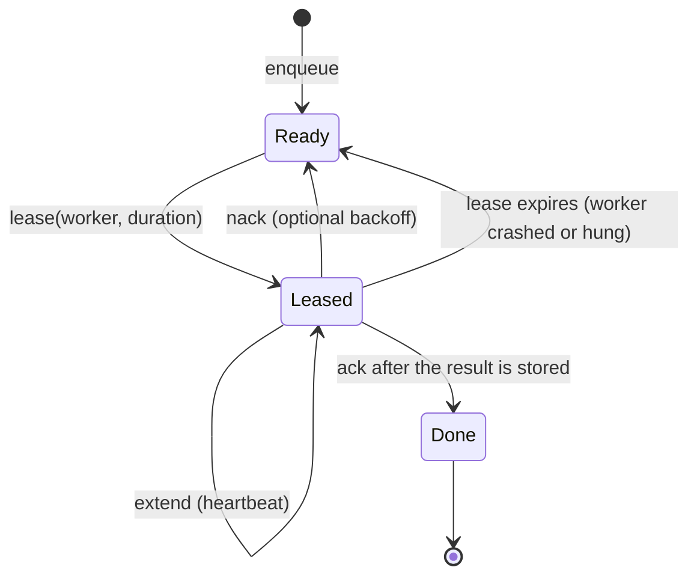

# Leases and delivery

A parked task is a promise: "this work was accepted and will run". Keeping that
promise across crashes is the job of the queue. This chapter covers the ideas
that make a queue durable without losing or silently duplicating work: leases,
at-least-once delivery, `SKIP LOCKED`, idempotency and the outbox pattern.

## The idea

Taking work from a queue has two dangerous moments:

- **Remove, then run.** If the worker deletes the task when it takes it and
  then crashes, the task is gone. This is *at-most-once* delivery.
- **Run, then remove.** If the worker takes a task without removing it, another
  worker may take it too, and if the worker crashes after finishing but before
  removing it, the task runs again. This is *at-least-once* delivery.

A **lease** makes the second option safe enough to use. Taking a task grants the
worker a time-limited right to it. While the lease is valid, nobody else may
take the task. The worker either **acknowledges** it (the task is done and is
removed), **releases** it (put it back, perhaps after a delay), or **extends**
the lease because it is still working. If the worker dies, the lease simply
expires and the task becomes available again.

Leases trade a possible duplicate for never losing work. Duplicates are then
handled by making the effect of a task **idempotent**: applying it twice has the
same result as applying it once.

## History

### Leases (Gray and Cheriton, 1989)

Cary Gray and David Cheriton introduced leases at SOSP in 1989 as a mechanism
for consistent distributed file caching. A lease is a time-bounded grant: the
holder may act on the data until the term ends, without further messages. Their
key observation is that failures (a crashed client, a lost message) then affect
performance, not correctness: the server only has to wait for the lease to
expire. They found that short terms, on the order of seconds, work well
([Gray and Cheriton, 1989](https://doi.org/10.1145/74850.74870);
[paper PDF](https://courses.cs.duke.edu/spring15/cps210/readings/leases-sosp89.pdf)).

The same idea appears in managed queues as the *visibility timeout*. In Amazon
SQS, a received message stays in the queue but is invisible to other consumers
until the timeout ends; if it is not deleted in time it becomes visible again.
The SQS documentation states that, because of the at-least-once model, a message
can still be delivered more than once, and it recommends a heartbeat that
extends the timeout for long work
([AWS SQS visibility timeout](https://docs.aws.amazon.com/AWSSimpleQueueService/latest/SQSDeveloperGuide/sqs-visibility-timeout.html)).

### End-to-end acknowledgement

Saltzer, Reed and Clark's end-to-end argument (1984) explains why the
acknowledgement must come from the end that knows the work is complete: lower
layers cannot guarantee a function that only the application endpoints can
check ([Saltzer, Reed and Clark, 1984](https://doi.org/10.1145/357401.357402)).
For a scheduler this means: acknowledge the queue entry only **after** the
result is safely stored, not when the executor returns.

### `SKIP LOCKED` (PostgreSQL 9.5, 2016)

A Postgres table can serve as a queue, but naive dequeuing serialises: every
worker selects the same head row and waits on its row lock. PostgreSQL 9.5,
released on 7 January 2016, added the `SKIP LOCKED` option to `SELECT ... FOR
UPDATE` (contributed by Thomas Munro): rows that cannot be locked immediately
are skipped instead of waited on
([PostgreSQL 9.5 release notes](https://www.postgresql.org/docs/9.5/release-9-5.html)).
The current documentation says this "provides an inconsistent view of the data,
so this is not suitable for general purpose work, but can be used to avoid lock
contention with multiple consumers accessing a queue-like table"
([PostgreSQL SELECT, the locking clause](https://www.postgresql.org/docs/current/sql-select.html)).

### pgmq

pgmq is a Postgres extension (also installable as plain SQL) that provides an
SQS-like queue inside Postgres: messages are read with a visibility timeout,
stay in the queue until explicitly deleted or archived, and can be archived for
retention and replay ([pgmq README](https://github.com/pgmq/pgmq);
[pgmq documentation](https://pgmq.github.io/pgmq/)). It has no priority levels
of its own; the project plan uses one queue per priority.

### Idempotency and the outbox

Pat Helland argued that in systems without distributed transactions, messages
must be expected to arrive more than once, so the receiving side has to make
processing idempotent
([Helland, CIDR 2007](https://www.cidrdb.org/cidr2007/papers/cidr07p15.pdf);
[Helland, "Idempotence Is Not a Medical Condition", 2012](https://doi.org/10.1145/2181796.2187821)).
The common technique is an idempotency key carried with the work, and a store
that applies the first write for that key and ignores later ones.

The **transactional outbox** solves the matching problem on the sending side:
write the message to an outbox table in the same database transaction as the
business change, and let a relay publish it later. The pattern's description
notes that the relay may publish a message more than once, so consumers must be
idempotent
([Richardson, Transactional outbox](https://microservices.io/patterns/data/transactional-outbox.html)).
In this library the outbox idea applies to results: store the result first,
then notify.

## How this library applies it

### What exists on `main`

The library does **not** provide leases or crash-durable delivery yet. Be
precise about what each backend does today:

- **`InMemoryQueue`** loses everything on restart, by design.
- **`PostgresQueue`** (SeaORM, table `pl_queue_jobs`) deletes the row inside
  the dequeue transaction, before the task runs. A crash after dequeue loses
  the task: this is at-most-once delivery. The table already has `locked_by`,
  `locked_at` and `attempts` columns, but nothing uses them. The module comment
  mentions `SKIP LOCKED`, but the query takes a plain `FOR UPDATE` lock, so
  concurrent dequeuers wait on the same head row. The backend also bridges to
  async code with `block_on`, which panics when called from inside a Tokio
  runtime.
- **`YaqueQueue`** is a JSON-lines file queue (not the `yaque` crate). It is
  FIFO only and rewrites the file on every dequeue without an atomic rename or
  `fsync`, so it is not crash-safe.
- **Idempotency.** `TaskMetadata` has an optional `idempotency_key`, and
  `InMemoryMailbox` has a first-write-wins index for it, but the `Mailbox`
  trait's `deliver` does not pass the key, so deduplication is not reached
  through the pool today.
- **Ordering of result and completion.** `ResourcePool` releases capacity and
  then writes the outcome to the mailbox. A failed mailbox write is logged, not
  retried.

### Planned

- `cr-25-backend-contracts`: an async `TaskQueue` with `lease`, `ack`, `nack`
  and `extend`, plus an async mailbox and a conformance suite.
- `cr-26-pg-lease-queue`: a Postgres lease queue on raw `sqlx` that claims with
  `FOR UPDATE SKIP LOCKED`, supports `not_before` backoff, wakes idle
  dispatchers with `LISTEN`/`NOTIFY`, and reclaims expired leases. Acceptance:
  a `kill -9` mid-task leads to redelivery after the lease expires, and several
  dispatchers never claim the same task.
- `cr-27-pg-mailbox`: consume-once (`DELETE ... RETURNING`), TTL eviction and
  first-write-wins idempotency (`ON CONFLICT`).
- `cr-28-embedded-redb-queue`: a crash-safe embedded queue on redb that
  honours priority.
- `cr-30-pgmq-sql-backend`: pgmq through SQL, one queue per priority.
- `cr-49-durable-dispatch`: pools persist accepted work through the durable
  queue, extend the lease while a task runs, and **acknowledge only after the
  mailbox write**, so a crash between execution and delivery causes a
  redelivery instead of a loss.

## Sources

1. Cary G. Gray, David R. Cheriton. "Leases: An Efficient Fault-Tolerant Mechanism for Distributed File Cache Consistency." *SOSP 1989*, pp. 202 to 210. [doi:10.1145/74850.74870](https://doi.org/10.1145/74850.74870)
2. Amazon Web Services. "Amazon SQS visibility timeout." SQS Developer Guide. [docs.aws.amazon.com](https://docs.aws.amazon.com/AWSSimpleQueueService/latest/SQSDeveloperGuide/sqs-visibility-timeout.html)
3. J. H. Saltzer, D. P. Reed, D. D. Clark. "End-to-End Arguments in System Design." *ACM Transactions on Computer Systems* 2(4), 1984, pp. 277 to 288. [doi:10.1145/357401.357402](https://doi.org/10.1145/357401.357402)
4. The PostgreSQL Global Development Group. "Release 9.5" (7 January 2016). [postgresql.org](https://www.postgresql.org/docs/9.5/release-9-5.html)
5. The PostgreSQL Global Development Group. "SELECT", section "The Locking Clause." [postgresql.org](https://www.postgresql.org/docs/current/sql-select.html)
6. pgmq project. README and documentation. [GitHub](https://github.com/pgmq/pgmq), [documentation](https://pgmq.github.io/pgmq/)
7. Pat Helland. "Life beyond Distributed Transactions: an Apostate's Opinion." *CIDR 2007*. [PDF](https://www.cidrdb.org/cidr2007/papers/cidr07p15.pdf)
8. Pat Helland. "Idempotence Is Not a Medical Condition." *ACM Queue* 10(4), 2012. [doi:10.1145/2181796.2187821](https://doi.org/10.1145/2181796.2187821)
9. Chris Richardson. "Pattern: Transactional outbox." microservices.io. [microservices.io](https://microservices.io/patterns/data/transactional-outbox.html)
