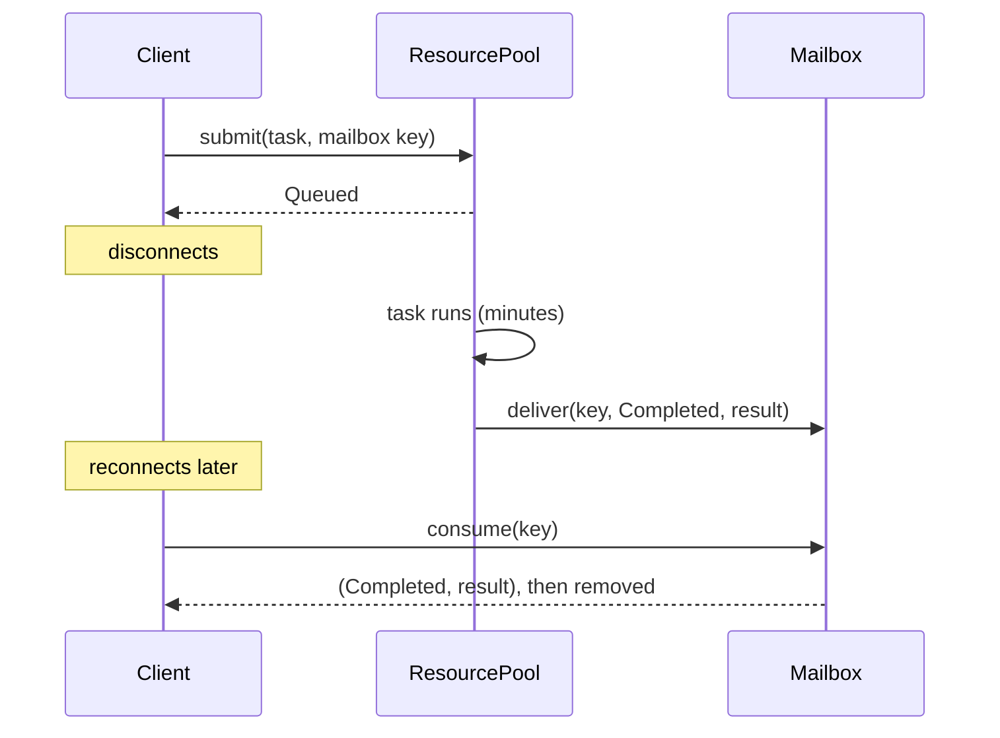

# Mailboxes and actors

A mailbox decouples the moment a result is produced from the moment someone
reads it. In this library the mailbox is where a finished task's outcome waits
for a client that may have disconnected. This chapter covers where the idea
comes from and how the library uses it.

## The idea

In a request and response call, the caller waits on an open connection for the
answer. If the work takes minutes and the connection drops, the answer has
nowhere to go.

A mailbox changes the contract. The caller hands over the work together with an
**address** (in this library, a `MailboxKey`: tenant, optional user, optional
session). The worker delivers the outcome to that address. The caller, or a
different process acting for it, collects the outcome whenever it reconnects.
Producer and consumer never need to be alive at the same time.

## History

### Actors (Hewitt, Bishop and Steiger, 1973)

Carl Hewitt, Peter Bishop and Richard Steiger proposed the actor formalism at
IJCAI in 1973: computation built from a single kind of object, the *actor*,
which interacts with others only by sending messages
([Hewitt, Bishop and Steiger, 1973](https://www.ijcai.org/Proceedings/73/Papers/027B.pdf)).
Gul Agha's 1986 book gave the model a precise semantics for distributed
systems: each actor has a mail address, and messages sent to it are buffered
until the actor processes them
([Agha, 1986](https://doi.org/10.7551/mitpress/1086.001.0001)).

The property that matters here is **asynchrony**: sending a message does not
wait for the receiver. The message waits in the receiver's mailbox instead.

### Erlang and OTP

Erlang, created at Ericsson, put actors into an industrial language. Joe
Armstrong's history of the language (HOPL III, 2007) traces its development at
Ericsson from 1986 onwards
([Armstrong, 2007](https://doi.org/10.1145/1238844.1238850)). The Erlang
documentation describes the mailbox exactly: "Each process has its own input
queue for messages it receives. New messages received are put at the end of the
queue." A `receive` takes the first message that matches one of its patterns
and leaves the others queued; when nothing matches, the process blocks until a
new message arrives
([Erlang concurrent programming guide](https://www.erlang.org/doc/system/conc_prog.html)).

Armstrong's 2003 thesis describes the other half of Erlang's reliability
story: processes are isolated, failures are detected and handled by supervisor
processes, and a crashed worker is restarted rather than repaired in place
([Armstrong, 2003](https://erlang.org/download/armstrong_thesis_2003.pdf)).

### What this library takes, and what it does not

The library is not an actor system. Its tasks do not send each other messages,
and a pool is not an actor. It takes two specific ideas:

- **Addressed, asynchronous delivery.** A task carries an optional address,
  and its outcome is delivered there whether or not anyone is listening.
- **Failures are values.** In Erlang a crash becomes a message to a supervisor.
  Here a failed, timed-out or expired task becomes a mailbox entry with a
  status (`Failed(TaskError)` or `Expired`) instead of silently vanishing.

| | Erlang mailbox | This library's mailbox |
| --- | --- | --- |
| Holds | Messages to a live process | Outcomes of finished tasks |
| Address | Process identifier | `MailboxKey` (tenant, user, session) |
| Read | `receive` with pattern matching | `consume(key)`: take and remove, at most once |
| Lifetime | Lives as long as the process | Optional TTL, removed by `evict_expired` |
| Survives restart | No | With the Postgres or redb mailbox |

## How this library applies it

### What exists on `main`

There are two mailbox contracts. The synchronous `Mailbox` trait is what the
in-memory `ResourcePool` writes to. The async `ResultMailbox` trait (cr-25, ADR
0003) is what the durable backends implement and what `DurableResourcePool`
writes to: `deliver` (with an optional idempotency key and TTL), `consume`,
`peek` and `evict_expired`. A delivery with a key is first-write-wins, and the
key is remembered after the result is consumed, so a redelivered task cannot
create a second result.

- **`ResourcePool` delivers every outcome** for tasks that carry a mailbox key:
  `Completed` with the value, `Failed(TaskError)` with no payload (including
  `Timeout` when a task exceeded its budget and `ExecutorPanicked` when the
  executor panicked, cr-21), and `Expired` for a queued task whose deadline
  passed before it could start. A task the in-memory `ResourcePool` cancels
  at shutdown receives `Failed(TaskError::Cancelled)` (cr-29); a durable pool
  delivers nothing for it and requeues it instead.
- **`InMemoryMailbox`** implements the whole synchronous trait: consume-once,
  TTL and eviction. **`InMemoryResultMailbox`** is the reference
  `ResultMailbox`. Neither survives a restart.
- **`PgResultMailbox`** (cr-27, table `pl_result_mailbox`, raw `sqlx`) is
  readable through the trait. `consume` is one `DELETE ... RETURNING` on a row
  locked with `FOR UPDATE SKIP LOCKED`, so a result reaches exactly one
  consumer. A duplicate delivery keeps the first write through
  `INSERT ... ON CONFLICT`. TTLs use database time, with `evict_expired` and a
  background sweeper (`spawn_sweeper`).
- **`RedbResultMailbox`** (cr-28) is the embedded mailbox, in the same redb
  file as the embedded queue. Every delivery, consume and eviction is one
  durable redb transaction.
- **`DurableResourcePool`** (cr-49) delivers to a `ResultMailbox` with an
  idempotency key before it acks the queue entry, so a crash between execution
  and delivery leads to a redelivery, and the first-write-wins key keeps
  exactly one result. See [Leases and delivery](./leases.md).
- **Storage plus notifier.** `StorageMailbox<S, N>` (cr-34) is a
  `ResultMailbox` that stores in `S` first and notifies only after the result
  is stored (a first-write-wins duplicate does not notify). The notification
  runs off the delivery path through `BackgroundNotifier`, which retries a
  failing notifier a bounded number of times with capped exponential backoff
  (`RetryPolicy`). A notifier
  failure is logged and counted (`NotifyStats`); it never fails or undoes a
  stored result.
- **Notifiers.** With the `iggy` feature, `IggyNotifier` (cr-32) publishes a
  `mailbox.ready` pointer to Apache Iggy after each stored result; without one
  (`NoopNotifier`), clients poll with `consume`. A durable pool built from the
  configuration has no notifier; start the pool with a `StorageMailbox` to add
  one ([Iggy events](../guides/iggy-events.md)).
- **The worker pools** keep results in their own in-process slots rather than
  in a mailbox, and these slots do not survive a restart. The native
  `WorkerPool` is read with `retrieve` or `retrieve_async`; unretrieved results
  are evicted after a TTL (`WorkerPool::with_result_ttl`, cr-22), a later
  retrieve reports `SchedulerError::ResultExpired`, and a timed-out retrieve
  leaves the result in its slot. The WASM `WorkerPool` has only
  `retrieve_async` and no result TTL.

Worked examples: [Disconnected clients](../guides/disconnected-clients.md).

## Sources

1. Carl Hewitt, Peter Bishop, Richard Steiger. "A Universal Modular ACTOR Formalism for Artificial Intelligence." *Proceedings of the 3rd International Joint Conference on Artificial Intelligence (IJCAI)*, 1973, pp. 235 to 245. [PDF](https://www.ijcai.org/Proceedings/73/Papers/027B.pdf)
2. Gul Agha. *Actors: A Model of Concurrent Computation in Distributed Systems.* MIT Press, 1986. [doi:10.7551/mitpress/1086.001.0001](https://doi.org/10.7551/mitpress/1086.001.0001)
3. Joe Armstrong. "A History of Erlang." *HOPL III*, 2007. [doi:10.1145/1238844.1238850](https://doi.org/10.1145/1238844.1238850)
4. Ericsson AB. "Concurrent Programming." Erlang/OTP System Documentation. [erlang.org](https://www.erlang.org/doc/system/conc_prog.html)
5. Joe Armstrong. *Making Reliable Distributed Systems in the Presence of Software Errors.* PhD thesis, Royal Institute of Technology (KTH), Stockholm, 2003. [PDF](https://erlang.org/download/armstrong_thesis_2003.pdf)
