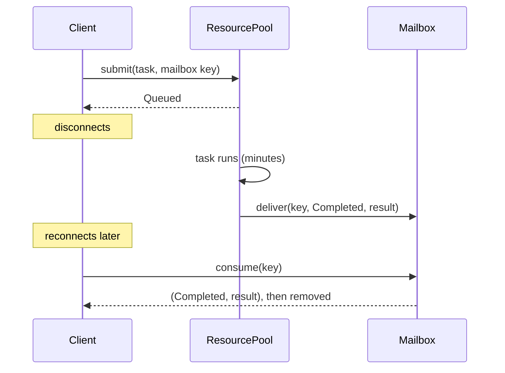

# Mailboxes and actors

A mailbox decouples the moment a result is produced from the moment someone
reads it. In this library the mailbox is where a finished task's outcome waits
for a client that may have disconnected. This chapter covers where the idea
comes from and how the library uses it.

## The idea

In a request and response call, the caller waits on an open connection for the
answer. If the work takes minutes and the connection drops, the answer has
nowhere to go.

A mailbox changes the contract. The caller hands over the work together with an
**address** (in this library, a `MailboxKey`: tenant, optional user, optional
session). The worker delivers the outcome to that address. The caller, or a
different process acting for it, collects the outcome whenever it reconnects.
Producer and consumer never need to be alive at the same time.

## History

### Actors (Hewitt, Bishop and Steiger, 1973)

Carl Hewitt, Peter Bishop and Richard Steiger proposed the actor formalism at
IJCAI in 1973: computation built from a single kind of object, the *actor*,
which interacts with others only by sending messages
([Hewitt, Bishop and Steiger, 1973](https://www.ijcai.org/Proceedings/73/Papers/027B.pdf)).
Gul Agha's 1986 book gave the model a precise semantics for distributed
systems: each actor has a mail address, and messages sent to it are buffered
until the actor processes them
([Agha, 1986](https://doi.org/10.7551/mitpress/1086.001.0001)).

The property that matters here is **asynchrony**: sending a message does not
wait for the receiver. The message waits in the receiver's mailbox instead.

### Erlang and OTP

Erlang, created at Ericsson, put actors into an industrial language. Joe
Armstrong's history of the language (HOPL III, 2007) traces its development at
Ericsson from 1986 onwards
([Armstrong, 2007](https://doi.org/10.1145/1238844.1238850)). The Erlang
documentation describes the mailbox exactly: "Each process has its own input
queue for messages it receives. New messages received are put at the end of the
queue." A `receive` takes the first message that matches one of its patterns
and leaves the others queued; when nothing matches, the process blocks until a
new message arrives
([Erlang concurrent programming guide](https://www.erlang.org/doc/system/conc_prog.html)).

Armstrong's 2003 thesis describes the other half of Erlang's reliability
story: processes are isolated, failures are detected and handled by supervisor
processes, and a crashed worker is restarted rather than repaired in place
([Armstrong, 2003](https://erlang.org/download/armstrong_thesis_2003.pdf)).

### What this library takes, and what it does not

The library is not an actor system. Its tasks do not send each other messages,
and a pool is not an actor. It takes two specific ideas:

- **Addressed, asynchronous delivery.** A task carries an optional address,
  and its outcome is delivered there whether or not anyone is listening.
- **Failures are values.** In Erlang a crash becomes a message to a supervisor.
  Here a failed, timed-out or expired task becomes a mailbox entry with a
  status (`Failed(TaskError)` or `Expired`) instead of silently vanishing.

| | Erlang mailbox | This library's mailbox |
| --- | --- | --- |
| Holds | Messages to a live process | Outcomes of finished tasks |
| Address | Process identifier | `MailboxKey` (tenant, user, session) |
| Read | `receive` with pattern matching | `consume(key)`: take and remove, at most once |
| Lifetime | Lives as long as the process | Optional TTL, removed by `evict_expired` |
| Survives restart | No | Only with a persistent backend |

## How this library applies it

### What exists on `main`

- **The `Mailbox` trait** has `deliver`, `deliver_with_ttl`, `consume`
  (consume-once: a successful consume removes the entry) and `evict_expired`.
  Its documentation requires backends with notifiers to store the result
  before notifying, so a notifier failure cannot lose a stored result.
- **`ResourcePool` delivers every outcome** for tasks that carry a mailbox key:
  `Completed` with the value, `Failed(TaskError)` with no payload (including a
  `Timeout` when a task exceeded its budget), and `Expired` for a queued task
  whose deadline passed before it could start.
- **`InMemoryMailbox`** implements the whole trait: consume-once, TTL and
  eviction. It does not survive a restart.
- **`PostgresMailbox`** (table `pl_mailbox_messages`) implements only
  `deliver`. `consume` and `evict_expired` fall back to the trait defaults
  (`None` and `0`), so results stored there cannot yet be read back through the
  trait. It also uses `block_on`, which panics inside a Tokio runtime.
- **`YaqueMailbox`** is a file-backed mailbox in the embedded crate.
- **The native `WorkerPool`** uses its own in-process result slots, read with
  `retrieve` or `retrieve_async`, rather than the `Mailbox` trait.
- There is **no notifier** on `main`: nothing tells a client that its result
  is ready. Clients poll with `consume`.

### Planned

- `cr-27-pg-mailbox`: Postgres consume-once (`DELETE ... RETURNING`), TTL
  eviction and first-write-wins on the idempotency key.
- `cr-34-mailbox-composition`: a mailbox built from storage plus an optional
  notifier, where a notifier failure never loses the stored result.
- `cr-32-iggy-events`: an Iggy notifier that publishes a "result ready" event
  (see [Event logs](./event-logs.md)).
- `cr-22-result-slots`: async result slots with a TTL for the worker pools.
- `cr-21-panic-containment`: a panicking executor becomes
  `TaskError::ExecutorPanicked` in the mailbox, in the spirit of "failures are
  values".

## Sources

1. Carl Hewitt, Peter Bishop, Richard Steiger. "A Universal Modular ACTOR Formalism for Artificial Intelligence." *Proceedings of the 3rd International Joint Conference on Artificial Intelligence (IJCAI)*, 1973, pp. 235 to 245. [PDF](https://www.ijcai.org/Proceedings/73/Papers/027B.pdf)
2. Gul Agha. *Actors: A Model of Concurrent Computation in Distributed Systems.* MIT Press, 1986. [doi:10.7551/mitpress/1086.001.0001](https://doi.org/10.7551/mitpress/1086.001.0001)
3. Joe Armstrong. "A History of Erlang." *HOPL III*, 2007. [doi:10.1145/1238844.1238850](https://doi.org/10.1145/1238844.1238850)
4. Ericsson AB. "Concurrent Programming." Erlang/OTP System Documentation. [erlang.org](https://www.erlang.org/doc/system/conc_prog.html)
5. Joe Armstrong. *Making Reliable Distributed Systems in the Presence of Software Errors.* PhD thesis, Royal Institute of Technology (KTH), Stockholm, 2003. [PDF](https://erlang.org/download/armstrong_thesis_2003.pdf)
