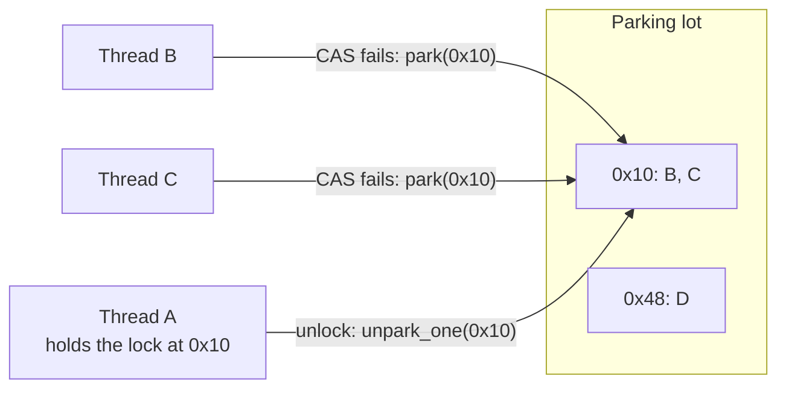
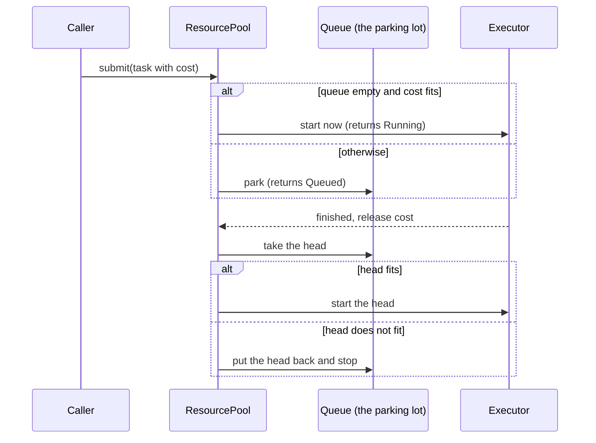

# Parking lots

The name "parking lot" comes from lock implementation. This chapter covers that
history and then explains how this library uses the name for a different thing:
it parks **work**, not threads.

## The idea

A lock has a fast path and a slow path. When nobody else holds the lock, a
thread should get it with one atomic instruction and never talk to the
operating system. Only when the lock is contended does the thread need
somewhere to wait: a queue, and a way to sleep until it is woken.

A *parking lot* moves that slow path out of the lock (in the diagram, a table from lock address to the queue of sleeping threads). The lock keeps only a few
bits of state. The waiting threads live in a separate, shared structure keyed by
the address of the lock they are waiting on. A thread that cannot get the lock
*parks* itself under that address. The thread that releases the lock *unparks*
one or more waiters from the same address.

Because the queue lives outside the lock, the lock itself can be tiny, and a
program can hold millions of locks that cost almost nothing until they are
actually contended.

## History

### Futexes (Linux, 2002)

Hubertus Franke, Rusty Russell and Matthew Kirkwood described *futexes* (fast
user-space mutexes) at the Ottawa Linux Symposium in 2002. Their abstract
states the principle directly: processes share lock state through shared memory
and atomic operations, and "kernel involvement is only necessary when there is
contention on a lock, in order to perform queueing and scheduling functions."
The paper says the kernel side had been integrated into Linux 2.5.7. The kernel
keeps the wait queues, keyed by the address of the user-space lock word. That
address-keyed wait queue is the seed of every parking lot that followed
([Franke, Russell and Kirkwood, 2002](https://www.kernel.org/doc/ols/2002/ols2002-pages-479-495.pdf);
[futex(2)](https://man7.org/linux/man-pages/man2/futex.2.html)).

### WebKit's `WTF::ParkingLot` (2015 to 2016)

Filip Pizlo's post "Locking in WebKit" (6 May 2016) describes how WebKit
replaced its spinlocks and OS mutexes with `WTF::Lock` in August 2015.
`WTF::Lock` needs two bits of a single byte. All queueing is delegated to
`WTF::ParkingLot`, which the post calls "a portable user-level implementation of
the core futex API": one concurrent hash table of queues, keyed by the address
of a lock's atomic state and shared by the whole process. Pizlo credits futexes
and earlier compact-lock work in Java virtual machines as the inspiration
([Pizlo, 2016](https://webkit.org/blog/6161/locking-in-webkit/)).

### Rust's `parking_lot` crate (2016)

Amanieu d'Antras published `parking_lot` on crates.io in May 2016 (version
0.1.0 is dated 13 May 2016). Its README says the idea "is based on the WebKit
`WTF::ParkingLot` class", a hash table mapping lock addresses to queues of
parked threads, and that the WebKit design was itself inspired by Linux futexes.
The crate's `Mutex` needs one byte; uncontended acquisition is a single atomic
operation; contended threads spin a few times and then park
([parking_lot README](https://github.com/Amanieu/parking_lot#the-parking-lot);
[crates.io version history](https://crates.io/crates/parking_lot/versions)).

This library uses that crate for its own short internal critical sections: the
`ResourcePool` queue and mailbox guards are `parking_lot::Mutex`.

## How this library differs: it parks work

A lock parking lot answers the question "which **thread** may proceed?". The
resource being protected is a memory location, its capacity is one holder, and
the thing that waits is a thread.

This library answers a different question: "which **task** may start, given
how much of a scarce resource it needs?". The resource is something like GPU
memory, measured in units; its capacity is many units; and what waits is a
description of work that has not started. Nothing sleeps while it waits. The
task is a value in a queue, which is why it can, with a durable queue backend,
be written to storage and outlive the process.

| | Lock parking lot | This library's parking lot |
| --- | --- | --- |
| What waits | A thread | A task description (payload and metadata) |
| Capacity | One holder (or many readers and one writer) | `max_units` of a resource, shared by many tasks |
| Admission test | The lock bit is free | `active_units + cost <= max_units` |
| Wait order | Usually FIFO, sometimes barging for throughput | Priority, then submission order |
| Wake trigger | Unlock | A running task finishes and releases its units |
| Survives a crash | No: threads die with the process | Only with a durable queue (see [Leases and delivery](./leases.md)) |

The field this belongs to is **admission control**, covered in the
[next chapter](./admission-control.md). The parking-lot name is kept because the
shape is the same: a fast path that starts work at once when capacity is free,
and a slow path that parks the work in a queue and wakes it when capacity is
released.

## What the library does today

On `main`, every pool parks work through one `Dispatcher` (cr-19, crate
`prometheus-parking-lot-core`). The dispatcher owns the parked queue and a
unit-weighted `UnitSemaphore`, so admission, parking and waking happen under
one lock with no lost wakeup. `ResourcePool`, the native `WorkerPool`
(`prometheus-parking-lot-runtime-tokio`) and the WASM `WorkerPool` (cr-38) all
admit through it:

- `submit` starts the task immediately only when nothing is parked ahead of it
  and its cost fits the free units. Otherwise the task is parked and `submit`
  returns `TaskStatus::Queued`.
- A task whose cost exceeds the pool's total capacity is rejected with
  `SchedulerError::CapacityExceeded`: parked at the head of the queue it would
  block every task behind it forever.
- When a task finishes, its units are returned and the dispatcher starts parked
  tasks by priority, then submission order, while the head fits. A head that
  does not fit keeps its place and stops dispatch.

The parking lot is in memory unless the pool is durable. `DurableResourcePool`
(cr-49) keeps every accepted task in a durable lease queue (Postgres or redb)
and leases the head into the same dispatcher, so parked work survives a
restart. See [Leases and delivery](./leases.md).

## Sources

1. Hubertus Franke, Rusty Russell, Matthew Kirkwood. "Fuss, Futexes and Furwocks: Fast Userlevel Locking in Linux." *Proceedings of the Ottawa Linux Symposium*, 2002, pp. 479 to 495. [PDF](https://www.kernel.org/doc/ols/2002/ols2002-pages-479-495.pdf)
2. Linux man-pages project. "futex(2)." [man7.org](https://man7.org/linux/man-pages/man2/futex.2.html)
3. Filip Pizlo. "Locking in WebKit." WebKit blog, 6 May 2016. [webkit.org](https://webkit.org/blog/6161/locking-in-webkit/)
4. Amanieu d'Antras. `parking_lot` README, section "The parking lot." [GitHub](https://github.com/Amanieu/parking_lot#the-parking-lot)
5. crates.io. `parking_lot` version history (0.1.0 published 13 May 2016). [crates.io](https://crates.io/crates/parking_lot/versions)
