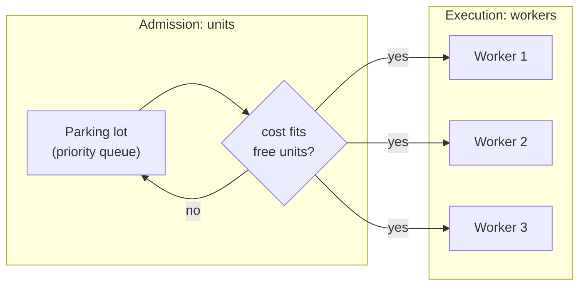

# Worker pools

Admission decides *whether* a task may start. A worker pool decides *where and
on which thread* it runs. This chapter covers worker pools and work stealing,
and explains how the library combines them with its parking lot.

## The idea

Creating a thread per task is expensive and unbounded. A **worker pool** keeps a
fixed set of long-lived workers and feeds them tasks through a queue. The pool
bounds concurrency by the number of workers, amortises thread start-up, and
gives one place to observe and shut down execution.

A pool of N workers limits how many tasks run at once. It does **not** limit how
much of a resource those tasks use. Four workers can run four tasks that each
need 10 GB of GPU memory on a 24 GB card. That is why this library treats
admission (units) and execution (workers) as two separate limits.

## History

### Work stealing (Blumofe and Leiserson; Cilk)

When workers each keep their own queue of tasks, some run dry while others are
overloaded. **Work stealing** fixes this: an idle worker takes work from the
queue of a busy one. Robert Blumofe and Charles Leiserson gave a randomised
work-stealing scheduler for fully strict multithreaded computations with
proven bounds, presented at FOCS in 1994 and published in the
Journal of the ACM in 1999, with bounds on time, space and communication
([Blumofe and Leiserson, 1994](https://doi.org/10.1109/SFCS.1994.365680);
[Blumofe and Leiserson, 1999](https://doi.org/10.1145/324133.324234)).
The Cilk runtime system (Blumofe, Joerg, Kuszmaul, Leiserson, Randall and Zhou,
PPoPP 1995) put a work-stealing scheduler into a practical multithreaded
language runtime
([Blumofe et al., 1995](https://doi.org/10.1145/209936.209958)).

Doug Lea's fork/join framework for Java (2000) brought the same design to a
mainstream library: per-worker double-ended queues, with owners taking from one
end and thieves from the other
([Lea, 2000](https://doi.org/10.1145/337449.337465)).

### Tokio's scheduler (2019)

Tokio, the async runtime this library's native pools use, rewrote its
multi-threaded scheduler in 2019. Carl Lerche's post "Making the Tokio scheduler
10x faster" (13 October 2019) describes the design: "Each processor maintains
its own run queue"; idle processors steal from busy ones; and a "next task"
slot, which "the processor will always check ... before checking the run
queue", so a task woken by a message runs right after its sender while the data
is still in cache. The post credits the Go scheduler for its approach to
throttling wake-ups
([Lerche, 2019](https://tokio.rs/blog/2019-10-scheduler)).

### Why GPU and CPU-heavy work avoids the async scheduler

A work-stealing async runtime assumes tasks yield often. A task that runs a
long, blocking computation (model inference on the CPU, or a blocking call into
a GPU library) holds a runtime thread and delays every other task queued on it.
The usual remedy is to run such work on dedicated threads, outside the async
scheduler, and hand results back through a channel.

## How this library applies it

### What exists on `main`

- **`ResourcePool`** does not own threads. It hands each admitted task to a
  `Spawn` implementation (`TokioSpawner` on native), so execution runs on the
  application's Tokio runtime with its work-stealing scheduler. Every execution
  is bounded by `tokio::time::timeout` using the task's deadline or the pool's
  `default_timeout`; when the budget elapses, the executor future is dropped,
  which cancels it at its next await point. `DurableResourcePool` (cr-49) runs
  tasks the same way.
- **The native `WorkerPool`** spawns `worker_count` dedicated OS threads. Each
  thread runs its own single-threaded Tokio runtime and blocks on its task, so
  CPU or GPU-bound work does not stall the application's async runtime.
  Admission goes through the shared dispatcher (cr-19): it enforces
  `max_units`, serves parked tasks by priority, then submission order, and
  bounds admitted tasks by `worker_count`, so an admitted task always has a
  worker. Workers take admitted tasks from one shared channel (crossbeam).
  There is no work stealing between workers, and none is needed: a single
  shared queue already keeps every idle worker busy. Every execution runs
  under a budget (the task's deadline or `default_timeout_ms`, whichever is
  nearer); a task still running at its budget fails with `TaskError::Timeout`.
- **Panic containment (cr-21).** In `ResourcePool` and the native
  `WorkerPool`, an executor panic becomes `TaskError::ExecutorPanicked`, its
  units are released and parked work starts. A worker thread killed by a
  panic is replaced, so the pool keeps its worker count.
- **Shutdown policies (cr-29).** Every native pool has
  `shutdown_with(ShutdownPolicy) -> ShutdownReport`: `Drain`,
  `DrainThenCancel` (the default) or `CancelImmediately`. Submissions are
  refused at once and accepted work keeps running until the deadline. In
  `ResourcePool` and the native `WorkerPool`, the rest is then cancelled
  (under `Drain`, only the queued tasks), recorded with `TaskError::Cancelled`
  and offered to a `CancellationSink`, and the report accounts for every
  accepted task. `DurableResourcePool` stops leasing, hands the leased task
  waiting for capacity and every cancelled straggler back to its queue
  (`nack(Requeue)`), and reports a straggler still running under `Drain` as
  unsettled; tasks it never leased stay in the queue and are not counted.
- **The WASM `WorkerPool` (cr-38)** admits through the same dispatcher and runs
  each admitted task with `wasm_bindgen_futures::spawn_local`; the browser
  event loop is the scheduler, and there is no Tokio runtime and no thread.
  Budgets use JS timers. An executor panic cannot be caught on
  `wasm32-unknown-unknown`: it aborts the module, so executors there must
  return errors, not panic.

### Planned

- `cr-53-wasm-parity`: the WASM pool follows the dispatcher changes that are
  still planned (skip-ahead, per-resource admission, lifecycle events).

## Sources

1. Robert D. Blumofe, Charles E. Leiserson. "Scheduling Multithreaded Computations by Work Stealing." *35th Annual Symposium on Foundations of Computer Science (FOCS)*, 1994, pp. 356 to 368. [doi:10.1109/SFCS.1994.365680](https://doi.org/10.1109/SFCS.1994.365680)
2. Robert D. Blumofe, Charles E. Leiserson. "Scheduling Multithreaded Computations by Work Stealing." *Journal of the ACM* 46(5), 1999, pp. 720 to 748. [doi:10.1145/324133.324234](https://doi.org/10.1145/324133.324234)
3. Robert D. Blumofe, Christopher F. Joerg, Bradley C. Kuszmaul, Charles E. Leiserson, Keith H. Randall, Yuli Zhou. "Cilk: An Efficient Multithreaded Runtime System." *PPoPP 1995*, pp. 207 to 216. [doi:10.1145/209936.209958](https://doi.org/10.1145/209936.209958)
4. Doug Lea. "A Java Fork/Join Framework." *Proceedings of the ACM 2000 Conference on Java Grande*, 2000. [doi:10.1145/337449.337465](https://doi.org/10.1145/337449.337465)
5. Carl Lerche. "Making the Tokio scheduler 10x faster." Tokio blog, 13 October 2019. [tokio.rs](https://tokio.rs/blog/2019-10-scheduler)
