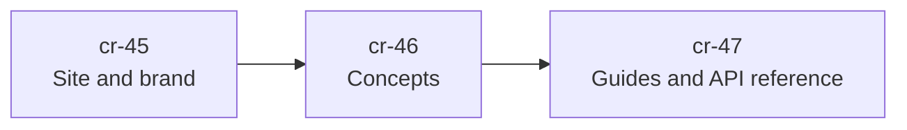

# Prometheus Parking Lot

Prometheus Parking Lot is a Rust library that schedules resource-constrained
work. Each task declares what it costs; a pool runs the task when its cost fits
in the remaining capacity and otherwise parks it until capacity frees. Results
go to a mailbox, so a client that disconnects can collect them later.

The library is being reworked in the **correctness-and-durability** phase. Its
goals are that weighted capacity is never exceeded, that accepted work is never
silently lost, and that results reach clients that disconnected. Until a goal
ships, treat it as a goal; the
[changelog](https://github.com/Prometheus-AGS/prometheus-parking-lot-rs/blob/main/CHANGELOG.md)
records what has shipped.

## How this documentation is built

The site is delivered in three OpenSpec changes. Sections that are not written
yet are placeholders and say so at the top of the page.

| Section | Change | Status |
| --- | --- | --- |
| Site, theme, search and verification | `cr-45-docs-site` | In progress |
| [Concepts](./concepts/index.md) | `cr-46-docs-theory` | Placeholder |
| [Guides](./guides/index.md) | `cr-47-docs-guides` | Placeholder |

To build or check the site itself, see [Working on this site](./contributing/docs-site.md).
